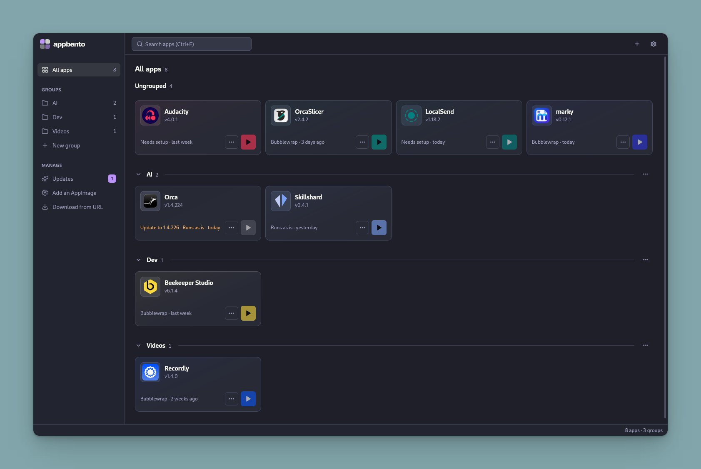

# AppBento

AppBento is a desktop AppImage manager for Linux. Bring scattered AppImages into one searchable library, organize them into groups, manage updates, and launch them with per-app settings and permissions.

**Choose what each app can access.** AppBento can run AppImages inside a **Bubblewrap (`bwrap`) sandbox container**, with an isolated filesystem and explicit access to your folders, network, display, audio, and GPU. Before an app's first launch, review its permissions and choose between sandboxed and unrestricted execution.



## Security model

An AppImage packages an application; it does not, by itself, restrict what that application can do. AppBento adds an optional isolation layer through Bubblewrap, using Linux namespaces and controlled filesystem mounts.

To enable it, open an app's **Permissions** settings and select **Restrict with bubblewrap**. The current initial selection is **Run without restrictions**, so sandboxing is an explicit choice for each app.

### What the sandbox restricts

- **Files:** your personal home folder is not shared by default. The app gets a separate home directory and temporary storage, with the AppImage and required system runtime files mounted read-only. Share only the folders it needs, choosing read-only or read/write access for each.
- **Network:** internet and local network access are blocked unless enabled.
- **Desktop and devices:** display, audio, and GPU access are separate permissions. Audio access allows both playback and microphone recording through the audio service.
- **App data:** an optional private home directory preserves the app's settings and data between launches without exposing your personal home. Disable persistence to use an ephemeral home instead.
- **Processes and environment:** separate user and process namespaces, dropped Linux capabilities, and a cleared inherited environment limit the app's access to the host.

The initial sandbox permission preset enables **display and private persistent data**. Network, audio, GPU, and shared folders are disabled. You can adjust these permissions later; system app-menu shortcuts use the saved launch policy too.

If Bubblewrap is unavailable or cannot create the sandbox, a sandboxed launch **fails instead of silently running unrestricted**. Choosing **Run without restrictions** explicitly runs the app with your account's normal access; sandbox permission toggles do not apply in that mode.

### Requirements and limits

Sandboxed launching requires **Bubblewrap 0.13 or newer** with `--ro-bind-fd` support and a system that permits the required Linux namespaces. Install the `bubblewrap` package using your distribution's package manager. AppBento checks availability in the Permissions settings. The sandbox launcher supports **Type 2 AppImages** and uses their extract-and-run mode.

The sandbox limits access; it does not establish that an application is trustworthy. Permissions open real access to host resources: writable shared folders can be modified, network permission includes local services, and **X11 display access can expose other windows and keyboard input**. The container shares the host kernel rather than providing a virtual machine. Grant only the access an app needs and use AppImages from sources you trust.

## Features

- **One library:** scan folders for local AppImages, add a file, or download one from a direct HTTPS URL.
- **Groups and search:** organize apps into groups and launch them from a compact grid.
- **Per-app launch settings:** configure permissions, command-line arguments, and environment variables; inspect launch logs when something goes wrong.
- **Desktop integration:** add or remove system app-menu shortcuts while keeping your AppImages in the library.
- **Updates:** configure GitHub Releases, GitLab Releases, or direct HTTPS sources, with release asset matching and architecture/channel options.
- **Themes:** choose from Tokyo Night, Gruvbox, Catppuccin, Nord, Dracula, Terminal green, and Paper.

Inspired by [Gear Lever](https://github.com/mijorus/gearlever) for feature ideas; AppBento uses original code.

## Stack

Tauri v2 (Rust) + React 19 + Tailwind v4 (shadcn-style `cva` components in `src/components/ui/`).

## Development

Requires Node.js 24+, pnpm 12+, Rust, and the Linux development prerequisites for Tauri v2. Bubblewrap is needed to test sandboxed launching in the full app.

```sh
sfw pnpm install
sfw pnpm dev            # web preview (mock data)
sfw pnpm tauri dev      # full app with Rust backend
cargo check -p appbento # backend check
pnpm check             # typecheck, lint, and tests
```

The web preview uses mock data: it does not launch AppImages or enforce sandbox permissions.
